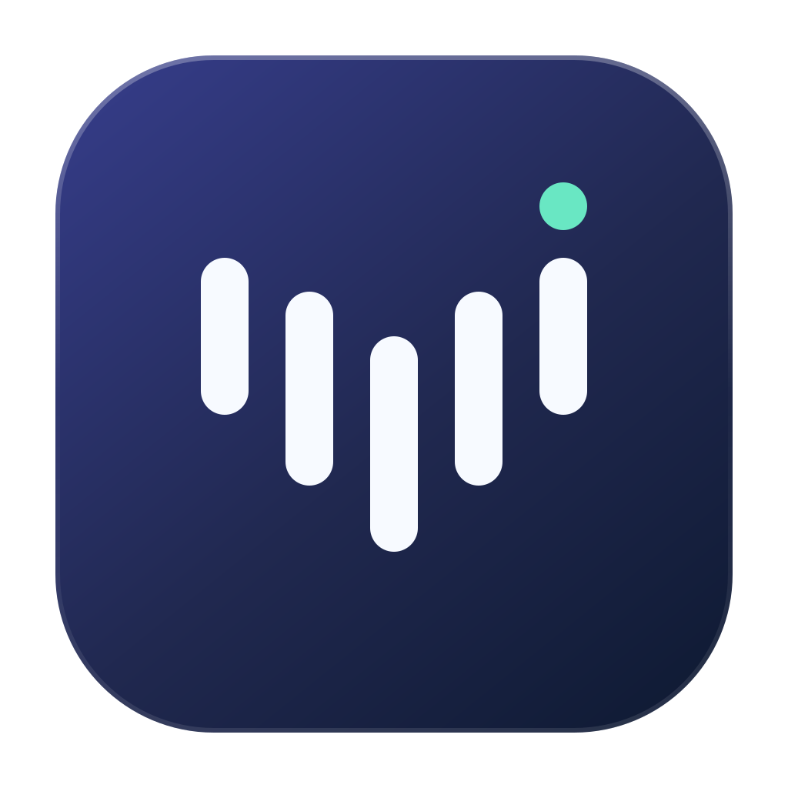

<p align="center"></p>
<h1 align="center">Voicemore</h1>
<p align="center">Speak naturally. Write where your cursor is.</p>
<p align="center"><a href="README.zh-CN.md">简体中文</a> · <a href="https://github.com/wherexml/Voicemore/releases/tag/v0.3.1">Download for Apple Silicon</a></p>

Voicemore is a native macOS dictation app. Press **Fn**, speak, and press **Fn** again to insert the transcript into the focused text field. Run speech recognition locally, connect a cloud provider, and optionally tidy your words with a language model.

## Download and install

**Apple Silicon (M-series), macOS 26.2 or later.** Intel Macs are not supported by this package. The current bundled MLX runtime sets the minimum OS requirement. Tested on macOS 27.0 arm64; older supported versions have not yet been tested end to end.

1. Download **Voicemore-0.3.1-arm64.dmg** from [v0.3.1 Releases](https://github.com/wherexml/Voicemore/releases/tag/v0.3.1).
2. Open the disk image and drag **Voicemore** onto **Applications**.
3. Eject the disk image, then open Voicemore from Applications.
4. Grant **Microphone**, **Accessibility**, and **Input Monitoring** in System Settings → Privacy & Security. Restart after granting keyboard permissions.
5. In **Settings → Models**, open the local speech model and choose download/deploy. Wait until it is ready, then try dictation in a text editor.

**Preview release:** v0.3.1 is development-signed, not Developer ID signed or notarized. macOS may block its first launch on another Mac. After checking the download source, use Apple's per-app **Privacy & Security → Open Anyway** flow if offered. Do not disable Gatekeeper globally. A fully notarized distribution is still pending; drag-to-Applications packaging does not remove this limitation.

The DMG includes the inference runtime, but **not model weights**. Initial local setup downloads roughly **2.47 GB** of model files and extracts roughly **0.65 GB** of runtime. Internet access is needed for the download; local recognition works offline after setup. You can also copy a compatible existing model. Cloud recognition needs your own provider credentials and network access.

## Updates

From **0.3.0**, Voicemore checks GitHub Releases about 10 seconds after launch and every hour while running. New versions appear in the top-right update control on every page and in the menu-bar tooltip; macOS notifications are attempted once per version and depend on system notification permissions.

Open the top-right update panel and click **Update & Restart** to download, verify the Ed25519-signed archive, replace the application, and restart automatically. You can cancel the download or retry a failed update. Dictation is paused during installation; updates wait for active dictation/model setup to finish. Settings, models, history and credentials are preserved. The app must be installed in a writable Applications location, not running from a read-only DMG.

**0.2.0 users must install 0.3.0 manually once.** Future releases must include the signed update archive and manifest; uploading only a DMG does not notify existing clients. See [publishing updates](docs/public/UPDATES.md).

## Features

- **Dictate into the active app:** configurable trigger key, toggle/hold behavior, recording feedback, and a compact transcription overlay.
- **Local speech recognition:** app-managed Qwen3-ASR-1.7B-8bit on Apple Silicon, with a separate inference process. No existing oMLX installation required for speech recognition.
- **Cloud options:** Alibaba Cloud and Volcengine speech recognition using your own accounts.
- **Optional text cleanup:** connect a local or compatible hosted language-model endpoint; cleanup is off by default.
- **History and playback:** review transcripts, edit results, and replay saved recordings.
- **Personal dictionary:** vocabulary hints, correction rules, and suggestions from edits. Suggested rules need confirmation; observing edits in other apps is opt-in.
- **Native interface:** Dock app, menu-bar controls, and English, Simplified Chinese, and Traditional Chinese UI.

Input behavior depends on the target app and macOS permissions. TextEdit dictation has been exercised; some editors and protected fields may behave differently. Fn can also trigger macOS's own action: set “Press 🌐 key to” to “Do Nothing”, or choose another shortcut.

## Privacy and storage

Local speech recognition sends audio only to the app's loopback worker (`127.0.0.1:48132`). Selecting a cloud speech provider sends audio to that provider. Enabling hosted text cleanup sends transcript text to the configured endpoint.

Settings, history, recordings, dictionary, models and encrypted credentials stay under:

```text
~/Library/Application Support/Voice Input/
```

The legacy directory name preserves existing installations after the Voicemore rename. API credentials use a local AES-GCM encrypted store; its encryption key is also stored locally with restrictive file permissions. This protects against casual plaintext exposure, not software running as your macOS user. Recording storage is enabled by default with a 30-day retention setting; adjust it in Settings → History & Privacy.

## Build from source

Requires an Apple Silicon Mac on macOS 26.2+, Xcode Command Line Tools, and **Go 1.27.1+**. Go dependencies are pinned in `go.mod`/`go.sum`.

```sh
git clone https://github.com/wherexml/Voicemore.git
cd Voicemore
# Downloads the versioned runtime asset and checks its SHA-256.
./scripts/fetch-asr-runtime.sh
# Local-only, ad-hoc signed build:
SIGNING_IDENTITY=- ./scripts/build-macos.sh
```

To sign with your own certificate, set `SIGNING_IDENTITY` to its full identity name. Public distribution additionally needs Developer ID signing and Apple notarization. No signing credentials are included in this repository. See [packaging and verification](docs/public/PACKAGING.md).

The runtime archive is a Release asset rather than a Git blob. Python dependencies and model revision/checksums live in `internal/localasr/assets/`. Model weights are fetched during setup. The archive retains third-party runtime licenses; [dependency notices](resources/licenses/README.md) cover bundled source dependencies and artwork.

## Project status

This is an early preview. The DMG's structure, copied bundle signature, architecture, runtime checksum and native app launch are verified locally. Cross-Mac Gatekeeper/notarization, Intel support, and broad target-app compatibility are not completed. [Report an issue](https://github.com/wherexml/Voicemore/issues) with your macOS version, chip and reproduction steps; remove recordings, transcripts and API keys before sharing logs.
